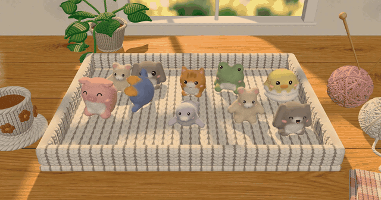
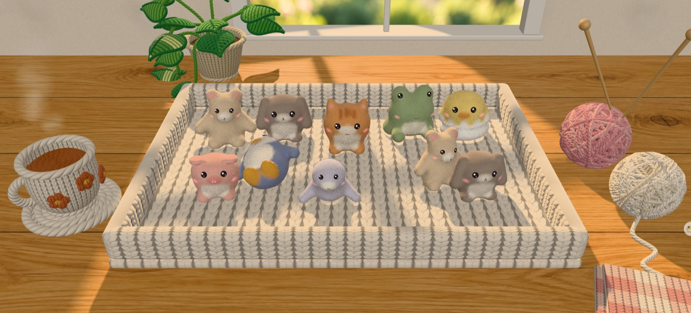
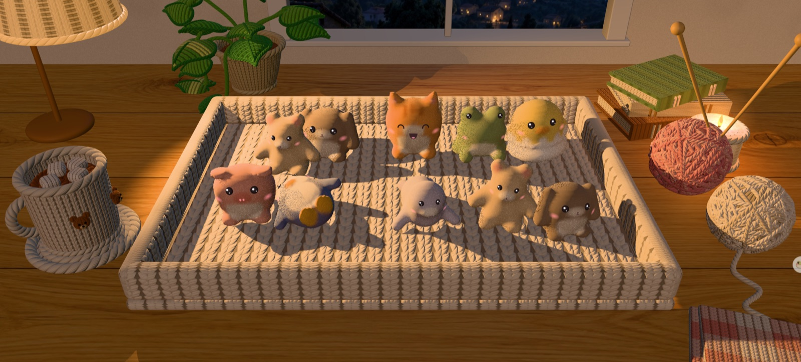

# Jelly Zoo

Chubby needle-felted animals packed into a knitted basket. Everything is soft-body: poke, squash, drag, pet and toss them.

**Play:** [jelly.krisyang.dev](https://jelly.krisyang.dev)



## Controls

| Action | What happens |
| --- | --- |
| Click an animal | It dents, wobbles and squints `> <`; its neighbours flinch |
| Press and hold | Squash it flat; let go and it springs into the air |
| Drag | Stretch it like mochi, release to throw |
| Stroke without pressing | Pet it: the fuzz lies down along your stroke, it blushes and coos |
| Hold on the empty floor | Rain more animals, up to 30 |
| Drag the rim / arrow keys | Tilt the basket and pour them out |
| Space | Shake the basket |

Leave them alone for a while and they fall asleep.

## The room

The basket sits on an oak table by a window, and the room follows your clock: afternoon sun through the panes by day, a desk lamp and a candle at night. Every prop around the basket is crocheted or knitted. Force a time with `?time=day` or `?time=night`.

| Day | Night |
| --- | --- |
|  |  |

## How it works

- **Soft bodies:** each animal is a cloud of particles held together by meshless shape matching (Müller et al. 2005) in a position-based dynamics loop, with robust rotation extraction (Müller et al. 2016). The basket walls are solid slabs, so bodies pile up and spill over the rim instead of poking through.
- **Skinning:** the visible mesh binds to its nearest particles and follows their deformation, face decals included.
- **Felt:** a matte mottled base plus instanced fuzz shells whose fibers are placed in rest-pose space, so they stretch with the body without seams. Petting writes a per-vertex comb vector that bends the fibers.
- **Knit:** basket and props use a procedural stitch shader (stockinette, rib, garter, seed, cable, bouclé) with stripe, check and fair isle colorwork.
- **Sound:** every boing, pop, purr and creak is synthesized with WebAudio and quantized to a pentatonic scale, so random poking sounds musical.

See [SPEC.md](SPEC.md) for the full design.

## Run locally

```bash
npm install
npm run dev
```

Built with [three.js](https://threejs.org) and [Vite](https://vite.dev). No other dependencies.

## License

MIT. By [Kris Yang](https://krisyang.dev).
